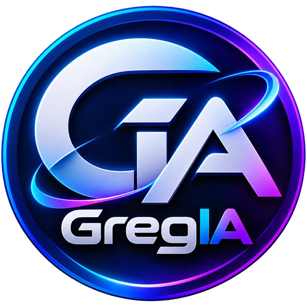

  

<h1 align="center">GregIA</h1>

  <b>Your 100% local AI assistant for Windows</b> 
  <b>Votre assistant IA 100 % local pour Windows</b>

  <a href="../../releases/latest"><b>⬇️ Download / Télécharger</b></a>
  &nbsp;·&nbsp;
  <a href="#english">English</a>
  &nbsp;·&nbsp;
  <a href="#français">Français</a>

---

## English

GregIA brings together chat, code, image generation, 3D and your documents in a single app, and **everything runs on your PC**. Your conversations, files and creations never leave your computer: no account, no subscription, no telemetry.

### What GregIA can do

- 💬 **Chat**: a large language model that answers, writes, summarizes and translates.
- 🧑‍💻 **Code**: a model specialized in programming. **▶ Run** Python and JavaScript right from the answer (charts included) and ask for a fix when it fails.
- 📁 **Projects**: a coding agent that works in a folder of your choice. It reads and edits files and runs commands (build, tests, git). It asks for your approval first, and every change can be undone in one click.
- 🖼️ **Images**: describe an image and GregIA creates it (Z-Image-Turbo or SDXL).
- 🧊 **3D**: turn an image into a 3D model you can rotate and export as `.glb` (Hunyuan3D).
- 📄 **Documents**: attach PDFs (scanned ones too), Word files, text or code, then ask questions. Answers cite their sources.
- 🎤 **Voice**: dictate your messages and listen to the answers read aloud.
- 🖥️ **Hardware advisor**: shows what your PC can do and measures the real speed of the models.
- 🔌 **Local API** compatible with OpenAI, for VS Code and other tools.
- 🌐 **French and English** interface, chosen when you install.

### Requirements

- Windows 10 or 11, 64-bit
- An **NVIDIA graphics card**: 8 GB of VRAM minimum, 24 GB recommended (e.g. RTX 3090 / 4090)
- 16 GB of RAM (32 GB recommended)
- 45 to 100 GB of free disk space for the AI models
- An Internet connection for the **first setup only**. GregIA downloads its components and models from their official sources (GitHub, Hugging Face), then works offline.

### Install

1. Download **`GregIA-x.y.z-setup.exe`** from the [latest release](../../releases/latest).
2. Run it and choose **English** or **French**.
3. On first launch, GregIA checks your PC, recommends the right profile and installs what it needs, step by step.

> Windows may show a SmartScreen warning because the installer is not code-signed: click **More info → Run anyway**.

### Updates

GregIA checks for a new version at startup. When one is available, a banner shows what's new: one click downloads it, another installs it and restarts the app. Your settings, conversations and models are kept. The installer is verified (SHA-256) before it runs. You can turn this check off in **Settings → About**.

### Privacy

- Models run on your graphics card; nothing is sent to an online AI service.
- The only network connections are the downloads of components and models, and the update check (GitHub). Neither sends any personal data.

---

## Français

GregIA réunit le chat, le code, la création d'images, la 3D et vos documents dans une seule application, et **tout tourne sur votre PC**. Vos conversations, vos fichiers et vos créations ne quittent jamais votre ordinateur : pas de compte, pas d'abonnement, pas de télémétrie.

### Ce que GregIA sait faire

- 💬 **Chat** : un grand modèle de langage qui répond, rédige, résume et traduit.
- 🧑‍💻 **Code** : un modèle spécialisé en programmation. **▶ Exécutez** le Python et le JavaScript directement depuis la réponse (graphiques compris) et demandez une correction en cas d'erreur.
- 📁 **Projets** : un agent de programmation qui travaille dans le dossier de votre choix. Il lit et modifie les fichiers et lance des commandes (build, tests, git). Il demande d'abord votre accord, et chaque modification s'annule en un clic.
- 🖼️ **Images** : décrivez une image, GregIA la crée (Z-Image-Turbo ou SDXL).
- 🧊 **3D** : transformez une image en modèle 3D à faire tourner et à exporter en `.glb` (Hunyuan3D).
- 📄 **Documents** : joignez des PDF (même scannés), des fichiers Word, du texte ou du code, puis posez vos questions. Les réponses citent leurs sources.
- 🎤 **Voix** : dictez vos messages et écoutez les réponses lues à voix haute.
- 🖥️ **Conseiller matériel** : il indique ce que votre PC peut faire et mesure la vitesse réelle des modèles.
- 🔌 **API locale** compatible OpenAI, pour VS Code et d'autres outils.
- 🌐 Interface en **français et en anglais**, au choix à l'installation.

### Configuration requise

- Windows 10 ou 11, 64 bits
- Une **carte graphique NVIDIA** : 8 Go de VRAM minimum, 24 Go conseillés (ex. RTX 3090 / 4090)
- 16 Go de mémoire vive (32 Go conseillés)
- 45 à 100 Go d'espace disque libre pour les modèles d'IA
- Une connexion Internet **pour la première installation seulement**. GregIA télécharge ses composants et ses modèles depuis leurs sources officielles (GitHub, Hugging Face), puis fonctionne hors ligne.

### Installation

1. Téléchargez **`GregIA-x.y.z-setup.exe`** depuis la [dernière version](../../releases/latest).
2. Lancez-le et choisissez **français** ou **anglais**.
3. Au premier lancement, GregIA analyse votre PC, recommande le bon profil et installe ce dont il a besoin, étape par étape.

> Windows peut afficher un avertissement SmartScreen, car l'installateur n'est pas signé : cliquez sur **Informations complémentaires → Exécuter quand même**.

### Mises à jour

GregIA vérifie au lancement s'il existe une nouvelle version. Si oui, un bandeau présente les nouveautés : un clic pour la télécharger, un autre pour l'installer et redémarrer. Vos réglages, conversations et modèles sont conservés. L'installateur est vérifié (SHA-256) avant d'être lancé. Vous pouvez désactiver cette vérification dans **Paramètres → À propos**.

### Confidentialité

- Les modèles tournent sur votre carte graphique ; rien n'est envoyé à un service d'IA en ligne.
- Les seules connexions réseau sont le téléchargement des composants et des modèles, et la recherche de mises à jour (GitHub). Aucune n'envoie de données personnelles.

---

Ce dépôt ne contient que les installateurs de GregIA. · This repository only contains the GregIA installers.

